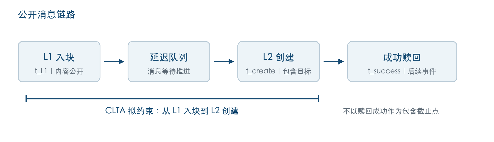
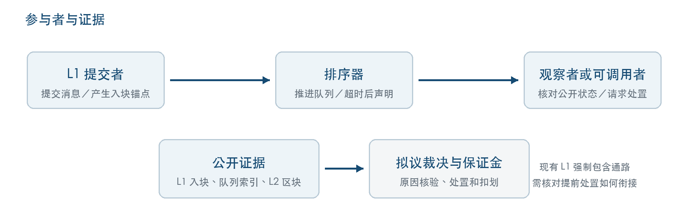
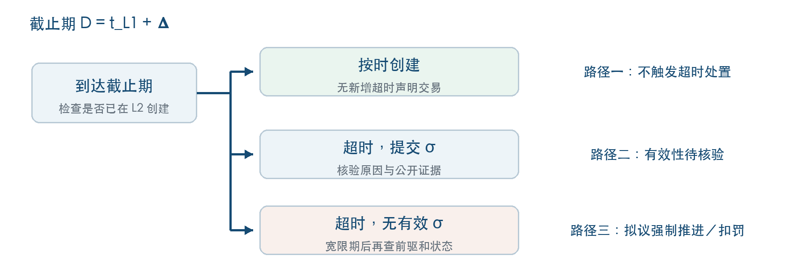
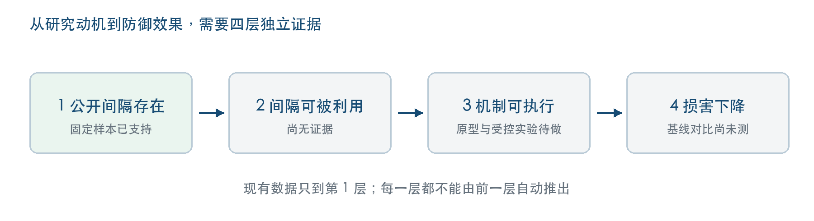

# CLTA 跨层时序可归责机制设计说明

杨帆｜2026 年 9 月 30 日｜供导师阅读的机制设计稿

**核心说明。** CLTA（Cross-Layer Temporal Accountability）面向 Arbitrum One 的 L1→L2 delayed message／retryable 链路，为每条已进入 L1 的消息拟设一个可公开检查的包含截止期。排序器若未在期限内推进消息，需要提交可核验的超时说明；若未按规则说明，则进入拟议的强制推进与保证金处置流程。它希望缩短和约束跨层消息公开后的等待阶段。**目前这是机制方案，尚无原型或防御效果实验。**

## 1 研究问题与机制位置

L1 提交的消息进入延迟队列后，需在 L2 创建，之后才可能发生成功赎回。消息及其 L1 入块时间是公开信息。现有 Delayed Inbox 已有一条超时后的 L1 强制包含通路；Arbitrum 官方文档将其描述为超过最大延迟后任何人可调用的抗审查路径。因此，CLTA 的新增目标不是发明强制包含本身，而是研究**更短的包含期限、超时说明以及责任约束**能否与现有通路衔接。具体协议改动尚待设计和验证。[1][2]

在已冻结的 53 个自动赎回成功对象中，L1 入块与 L2 创建所在区块的时间戳差值为 404–767 秒，中位数 558 秒，P90 为 720 秒。[3][4] 这个差值表明公开的跨层时间间隔存在；它不能直接量出排序器的真实处理耗时，也不能证明有人利用这一间隔获利。

*图 1　时间观察止于 L2 创建；成功赎回是后续事件。蓝色标注为 CLTA 拟约束的包含阶段，图中不表示现网已部署 CLTA。*

<!-- pagebreak -->

## 2 设计理念

研究样本中，延迟消息的公开顺序与创建顺序一致；这与队列按序消费的协议解释相容，但不能推出排序器总体公平，也不能证明所有环境均不可跳过。[5] 对这条链路，CLTA 首先关注**消息何时被推进**，并把“过了截止期仍未推进”“是否提交有效声明”转化为可检查的状态。它不要求观察私有的 first-seen 到达顺序。

机制的责任对象是**超时后的行为与声明义务**，不是仅凭两个时间戳推断排序器动机。是否能够进一步把成因唯一归于排序器，取决于队列语义、合法例外以及时间戳误差等额外前提；这一层推断与超时状态判定分开。[3][5]

CLTA 涉及四类角色：L1 提交者提供消息和入块锚点；排序器推进延迟队列，并在超时后按拟议规则说明原因；观察者依据公开数据检查状态；可调用者在规则允许时启动处置。声明核验、保证金托管和扣划，以及较现有路径更早的强制推进，都需要新增可执行的协议或合约支持。[3]

*图 2　实线表示公开消息和证据的关系；标为“拟议”的组件尚未实现。既有强制包含通路位于 L1，不能假定在 L2 被审查时仍可通过普通 L2 交易启动新处置。*

<!-- pagebreak -->

## 3 规则与判定路径

对消息 m，以 **t_L1(m)** 表示所在 L1 区块的时间戳，以 **t_create(m)** 表示 L2 创建所在区块的时间戳。CLTA 拟设协议参数 **Δ**（秒）和包含截止期 **D(m) = t_L1(m) + Δ**。这里的 Δ 是待制定的期限；观测量 **Δ_create = t_create − t_L1** 是历史样本中的时间戳差值，二者不能混用。**β** 是截止期后的声明宽限区块数，**σ** 是排序器签名的超时声明。[3]

**路径一，按时包含。** 若在 D(m) 前完成 L2 创建，CLTA 不要求新增超时声明交易。正常路径的实际延迟、gas 和存储增量尚未测量。

**路径二，超时且提交声明。** 排序器须在拟定宽限期内提交 σ，载明消息索引、高度和有限枚举的原因码。签名只证明“谁声明了什么”；是否免责，还须检查原因是否属于允许情形、是否由公开证据支持。该核验规则及争议处理尚未实现。

**路径三，超时且无有效声明。** 在检查消息未被包含、全部前驱已包含、宽限期已结束且无有效 σ 后，拟进入强制推进和保证金扣罚流程。这里的“三条件”只给出**可裁决的状态**，不能单独证明排序器恶意。提前强制推进如何与现有 L1 通路结合、谁有执行权限、保证金如何扣划，都属于待实现问题。

*图 3　流程是设计规则，不是已运行案例。图中“核验”包含合法原因检查；无有效声明也不自动等于恶意延迟。*

<!-- pagebreak -->

## 4 一个便于阅读的机制示例

假设消息 m 于 10:00:00 所在的 L1 区块入块，暂以 Δ = 1440 秒为讨论用的标定起点，则拟议截止期为 10:24:00。若 L2 创建发生在截止期之前，机制不要求超时声明。若到截止期仍未创建，则需要继续观察 β 个 L2 区块内的声明和包含状态；仅当宽限期结束、前驱均已包含且没有有效声明时，才满足上述拟议处置条件。这是**说明规则的假设案例**，不是链上发生过的 CLTA 触发记录。

1440 秒来自现有 53 对象样本的 **2 × P90**，只是待扩样重算的起点。[3][4] 本样本最大 Δ_create 为 767 秒，因此在这个阈值下，超过期限的**候选对象为 0/53**。即便改用 720 秒，5/53 也只是时间戳差值超过阈值的候选数，仍需排除合法原因、检查前驱和声明；它不是罚没数，更不是防御效果。

还有一个不能略过的运行边界：β 用 L2 区块数计量。如果 L2 不再出块，宽限期如何结束必须另设规则；若排序器审查处置交易，普通 L2 账户能否及时触发也没有保证。因而“任何人可触发”的设计目标需要落实到可用的 L1 路径或其他抗审查执行入口，并通过故障场景测试。

## 5 可能的优势

**围绕可公开核验的事实制定责任。** 截止期、队列前驱和声明记录原则上可由公开数据检查，使争议落到可提交的证据上。与此相伴的时间戳误差、链重组和例外原因仍需定义。

**减少对私有到达顺序的依赖。** CLTA 的基本状态判定不要求 first-seen 数据，适合研究当前无法观察私有接收队列的情形。若要作更强的成因归责，仍需核对队列不可跳过等实现层条件。

**为用户提供提前处置的研究方向。** 若能在现有强制包含机制之上安全实现更早的可调用路径，并配套可执行的保证金规则，超时后的处置将不再只靠排序器自愿推进。这是设计潜力，尚非实测收益。

<!-- pagebreak -->

## 6 局限与尚未解决的问题

**协议衔接尚不明确。** Arbitrum 已有超时强制包含机制。[1][2] CLTA 若要求更短期限，必须说明新增逻辑部署在何处、与现有等待参数如何兼容，以及 L2 停止出块或审查交易时的执行入口。当前材料没有完成这些接口设计。

**声明和罚则尚无可运行定义。** 原因码的证据要求、有效声明的核验与申诉、保证金的托管和强制扣划、罚金比例与误罚救济，都需要协议设计与测试。签名本身不自动免责，跨层时间戳差值也不能直接成为罚没证据。

**归责前提尚未验证。** “队列索引不可跳过”在现有 53 个已包含对象中属于**零观测＋实现层假定**；同一 L2 创建区块内的不同对象比较也没有样本。[3][5] 这些缺口限制唯一成因归责的强度，却不应被写成已完成的协议证明。

**样本和评测尚不足。** 现有时间分布来自单链、单日约 4.81 小时、单一自动赎回成功类型的 53 个对象。[3] Δ 取值可能受批处理节奏和样本选择影响；目前没有原型、受控滞留演示、开销数字或防御效果对比。

*图 4　已支持的是固定样本中的公开时间间隔；“可被利用”“机制可执行”“损害下降”分别需要独立证据，不能由前一层自动推出。*

<!-- pagebreak -->

## 7 当前进度与下一步验证

目前已完成固定样本的链路映射、时间锚点与顺序证据核对。53 个对象的 Δ_create 分布为 404–767 秒；1378 是这 53 个对象形成的**比较对数，不是独立样本数**。这些结果支持研究动机和标定讨论，尚不能证明窗口被利用或 CLTA 有效。[3][4][5]

下一步需要按依赖顺序推进：先扩充不同日期和生命周期类型的样本，并核对样本期部署版本及队列消费语义；再在受控环境中实现声明、核验、提前强制推进和保证金处置，制造可重复的超时与合法例外；最后测量误罚、漏罚、正常路径开销及抗审查故障情形。受控触发能够检验机制是否可执行；若要进一步声称经济损害下降，还需另设具体应用场景、反事实基线与可观察的损害指标。[3]

**现阶段可向老师确认的结论是：** CLTA 已形成一套围绕跨层包含时限、公开声明和处置责任的机制设计；现有链上样本支持其研究问题，但协议实现和防御有效性仍待验证。

## 资料来源

[1] Arbitrum Docs，Inside Arbitrum Nitro，Delayed Inbox 与 force inclusion 章节，https://docs.arbitrum.io/how-arbitrum-works/inside-arbitrum-nitro （访问于 2026-09-30）。

[2] Offchain Labs，Arbitrum Nitro: A Second-Generation Optimistic Rollup，Delayed Inbox 与强制包含说明，https://docs.arbitrum.io/nitro-whitepaper.pdf 。白皮书描述协议设计，不替代样本期部署版本核对。

[3] 项目内部技术文档《CLTA概述.md》，2026-09-18，尤其 §2、§2.6、§3、§4；此文档中的部分绝对化表述已按最新 PPT 和官方资料收窄。

[4] 《26秋0918第二周进度汇报-杨帆》，第 3–9 页；《26秋0929第三周进度汇报-杨帆》，第 3–7 页。

[5] 项目内部文档《协议约束、可观察顺序与防御研究位置》，2026-09-17，尤其 §三、§四。样本期部署版本的精确绑定仍待完成。
